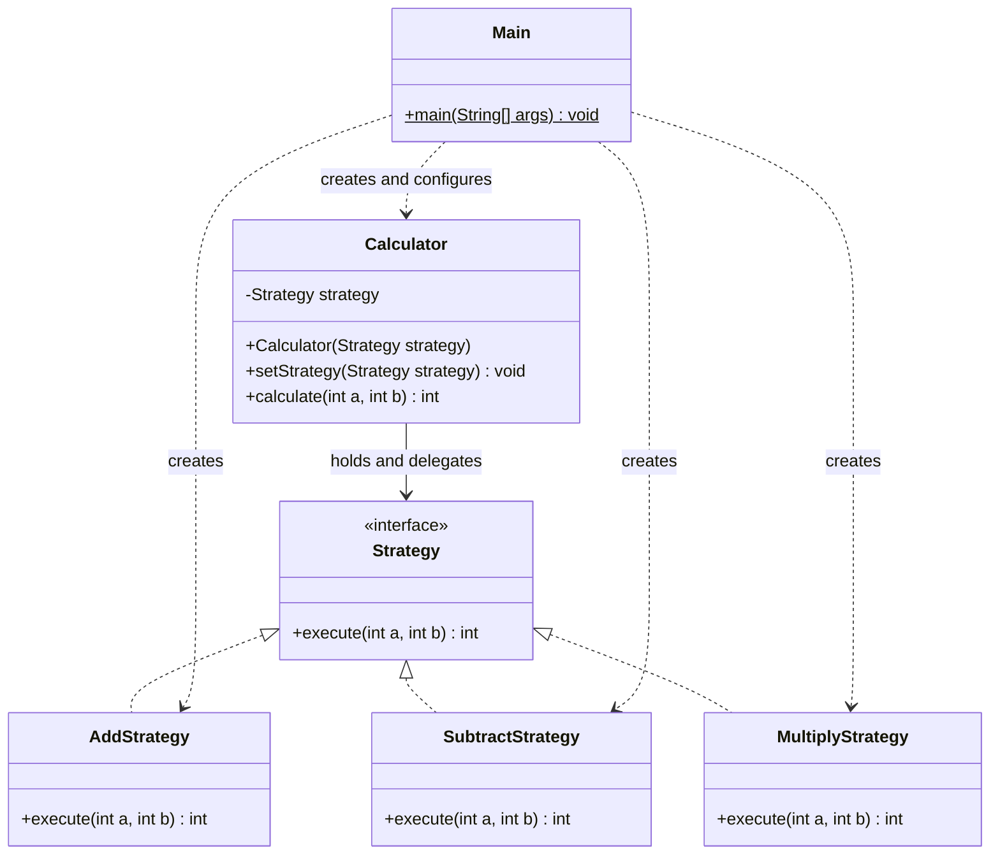

# Assignment 5 — Strategy Pattern

**Student:** Amerkhanova Aruzhan  
**Group:** SE-2529

## 1. Introduction

The selected domain is Option B, a calculator. Its algorithm family consists of
addition, subtraction and multiplication of two integers. Each operation is a
separate implementation of `Strategy`. The calculator delegates computation to
the selected strategy instead of choosing an operation through conditions.

The design follows Lecture 7: the client creates a concrete strategy, the context
stores it through an interface, and execution is delegated to that interface.
`Main` uses one calculator with the values 12 and 4, switching its strategy twice
during execution. The results are 16, 8 and 48.

## 2. UML class diagram



The dashed realization arrows show that each algorithm implements `Strategy`.
The calculator's association points to the interface, not to a concrete algorithm.
Client dependencies show where objects are created and configured.

## 3. Clean Code

### 3.1. Replace conditional algorithm selection with polymorphism

```java
public int calculate(int a, int b) {
    return strategy.execute(a, b); // The current object supplies the algorithm.
}
```

There is no operation-name comparison, `if`, `switch` or type check in the context.
The same call executes the selected implementation.

### 3.2. Meaningful names

```java
calculator.setStrategy(new SubtractStrategy()); // The operation is explicit.
System.out.println("Subtraction: " + calculator.calculate(a, b));
```

`Calculator`, `SubtractStrategy`, `setStrategy` and `calculate` describe their
purpose. The names identify both the operation and its role in the design.

### 3.3. Single Responsibility Principle

```java
public class AddStrategy implements Strategy {
    @Override
    public int execute(int a, int b) {
        return a + b; // Only addition: no input, output or strategy selection.
    }
}
```

Each strategy has one algorithm. `Calculator` delegates, and `Main` configures
objects and prints the demonstration. Changing output formatting does not require
editing the arithmetic classes.

### 3.4. Depend on an abstraction and encapsulate the reference

```java
private Strategy strategy; // Private and interface-typed.

public void setStrategy(Strategy strategy) {
    this.strategy = strategy;
}
```

The context knows the common contract rather than concrete implementations.
The private reference is configured through a public method. This follows the
lecture's guidance on encapsulation and depending on abstractions.

### 3.5. Open/Closed Principle

```java
public class MultiplyStrategy implements Strategy {
    @Override
    public int execute(int a, int b) {
        return a * b; // Another implementation of the unchanged contract.
    }
}
```

Multiplication is supplied by a separate implementation; `Calculator`,
`AddStrategy` and `SubtractStrategy` do not need to change to support it.
The client selects it with `calculator.setStrategy(new MultiplyStrategy())`.
Likewise, a future operation needs a new strategy and client configuration,
not a new branch in the calculator. Client wiring can change; the existing
algorithm implementations and context remain unchanged.

## 4. Strategy vs. State

Both patterns use composition and delegate behavior through an interface.
Strategy represents alternative algorithms selected by a client. State represents
behavior associated with an object's current state and transitions between states.
This calculator needs Strategy because the client explicitly chooses an arithmetic
operation. Addition does not trigger a transition into subtraction, and the
strategies do not manage a lifecycle or change the calculator's state themselves.
Changing the strategy reference alone does not make this the State pattern.

## 5. Conclusion

The calculator can change algorithms while keeping the same context object.
The interface and delegation make each operation small and easy to explain.
The cost is extra classes: one interface and five classes for three simple
operations. This is useful for demonstrating Strategy, although direct arithmetic
would be shorter for a fixed calculator without interchangeable algorithms.

## 6. Link to the GitHub repository

https://github.com/xelllion/SDP_assignment5

### Sources and assistance

- Assignment 5 — Strategy Pattern, 2026–2027: requirements and Option B.
- Almas Ospanov, *Lecture 7 — The Strategy Pattern*: slides 6–7 and 11–13
  (components and delegation), 20 (calculator), 23 (pattern relationships),
  35–42 (Clean Code and class design). Supplied course PDF.
- OpenAI Codex assisted with implementation, documentation and verification.
  This is an assisted project, not a claim of unaided work.
