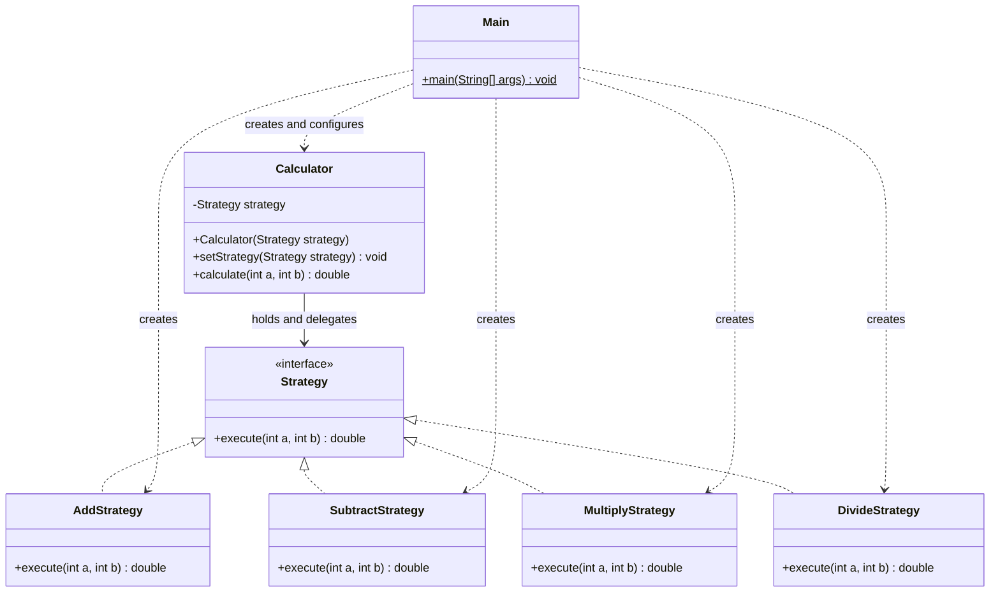

# Assignment 5 — Strategy Pattern

**Student:** Amerkhanova Aruzhan  
**Group:** SE-2529

## 1. Introduction

The selected domain is Option B, a calculator. Its algorithm family consists of
addition, subtraction, multiplication and division of two integers. Results use
`double` to preserve the fractional part of division. Each operation is a
separate implementation of `Strategy`. The calculator delegates computation to
the selected strategy instead of choosing an operation through conditions.

The design follows Lecture 7: the client creates a concrete strategy, the context
stores it through an interface, and execution is delegated to that interface.
`Main` uses one calculator and the values stored in `a` and `b`, switching its
strategy three times during execution. With the current values 12 and 0, the
first three results are 12.0, 12.0 and 0.0, followed by
`Warning: Cannot divide by zero.`. The actual division call is inside `try/catch`,
so the program finishes normally. Instructions for changing the operands and
checking normal, fractional and zero-divisor cases are in the README.
The zero-divisor check belongs to `DivideStrategy`; the context still contains
no algorithm-selection conditions.

## 2. UML class diagram



### Meaning of the UML arrows

| Connection | Line and arrowhead | Meaning in this project |
| --- | --- | --- |
| Each concrete strategy to `Strategy` (`Strategy <|.. ConcreteStrategy`) | Dashed line, hollow triangular arrowhead pointing to `Strategy` | Interface realization: the class uses `implements Strategy`, not class inheritance. |
| `Calculator --> Strategy` | Solid line, navigable association arrow pointing to `Strategy` | The calculator stores a `Strategy` field and delegates to it. |
| `Main ..> Calculator` and `Main ..> EachConcreteStrategy` | Dashed line, dependency arrow pointing to the used class | The client creates and uses these objects within `main`; it does not store them as fields. |

The association and dependency arrowheads are ordinary open arrowheads, not the
hollow triangles used for interface realization. A hollow triangle with a solid
line would represent class inheritance; this project has no such relationship.
A filled diamond would mean composition (exclusive whole-part ownership), and a
hollow diamond would mean shared aggregation. Neither diamond is needed here:
strategies are supplied from outside, can be replaced and can be shared between
calculators. A plain navigable association accurately represents the field.
“Composition over inheritance” as a design principle does not automatically mean
a UML composition diamond.

All four realization arrows point to the interface. `Calculator` has no direct
association with any concrete strategy. `Main.main` is static (the `$` suffix in
Mermaid); `+` marks public members and `-` marks the private strategy field.

## 3. Clean Code

The examples below include class and method context so IntelliJ can parse them.
The example wrappers belong only to this report; the project contains seven Java files.

### 3.1. Replace conditional algorithm selection with polymorphism

```java
class DelegationExample {
    private final Strategy strategy;

    DelegationExample(Strategy strategy) {
        this.strategy = strategy;
    }

    public double calculate(int a, int b) {
        return strategy.execute(a, b); // The object supplies the algorithm.
    }
}
```

There is no operation-name comparison, `if`, `switch` or type check in the context.
The same call executes the selected implementation.

### 3.2. Meaningful names

```java
class NamingExample {
    public static void main(String[] args) {
        int a = 12;
        int b = 4;
        Calculator calculator = new Calculator(new AddStrategy());
        calculator.setStrategy(new SubtractStrategy()); // Explicit operation.
        System.out.println("Subtraction: " + calculator.calculate(a, b));
    }
}
```

`Calculator`, `SubtractStrategy`, `setStrategy` and `calculate` describe their
purpose. The names identify both the operation and its role in the design.

### 3.3. Single Responsibility Principle

```java
public class AddStrategy implements Strategy {
    @Override
    public double execute(int a, int b) {
        return a + b; // Only addition; output belongs to the client.
    }
}
```

Each strategy has one algorithm. `Calculator` delegates, and `Main` configures
objects and prints the demonstration. Changing output formatting does not require
editing the arithmetic classes.

### 3.4. Depend on an abstraction and encapsulate the reference

```java
class EncapsulationExample {
    private Strategy strategy; // Private and interface-typed.

    EncapsulationExample(Strategy strategy) {
        this.strategy = strategy;
    }

    public void setStrategy(Strategy strategy) {
        this.strategy = strategy;
    }

    public double calculate(int a, int b) {
        return strategy.execute(a, b);
    }
}
```

The context knows the common contract rather than concrete implementations.
The private reference is configured through a public method. This follows the
lecture's guidance on encapsulation and depending on abstractions.

### 3.5. Open/Closed Principle

```java
public class MultiplyStrategy implements Strategy {
    @Override
    public double execute(int a, int b) {
        return a * b; // Another implementation of the same contract.
    }
}
```

Multiplication is supplied by a separate implementation; `Calculator`,
`AddStrategy` and `SubtractStrategy` do not need to change to support it.
The client selects it with `calculator.setStrategy(new MultiplyStrategy())`.
Likewise, a future operation needs a new strategy and client configuration,
not a new branch in the calculator. Client wiring can change; the existing
algorithm implementations and context remain unchanged.

## 4. Strategy vs. State

Both patterns use composition and delegate behavior through an interface.
Strategy represents alternative algorithms selected by a client. State represents
behavior associated with an object's current state and transitions between states.
This calculator needs Strategy because the client explicitly chooses an arithmetic
operation. Addition does not trigger a transition into subtraction, and the
strategies do not manage a lifecycle or change the calculator's state themselves.
Changing the strategy reference alone does not make this the State pattern.

## 5. Conclusion

The calculator can change algorithms while keeping the same context object.
The interface and delegation make each operation small and easy to explain.
The cost is extra classes: one interface and six classes for four simple
operations. This is useful for demonstrating Strategy, although direct arithmetic
would be shorter for a fixed calculator without interchangeable algorithms.

## 6. Link to the GitHub repository

https://github.com/xelllion/SDP_assignment5

### Sources and assistance

- Assignment 5 — Strategy Pattern, 2026–2027: requirements and Option B.
- Almas Ospanov, *Lecture 7 — The Strategy Pattern*: slides 6–7 and 11–13
  (components and delegation), 20 (calculator), 23 (pattern relationships),
  35–42 (Clean Code and class design). Supplied course PDF.
- OpenAI Codex assisted with implementation, documentation and verification.
  This is an assisted project, not a claim of unaided work.

- Mermaid documentation, [Class diagrams](https://mermaid.js.org/syntax/classDiagram.html): relationship notation and static members.
